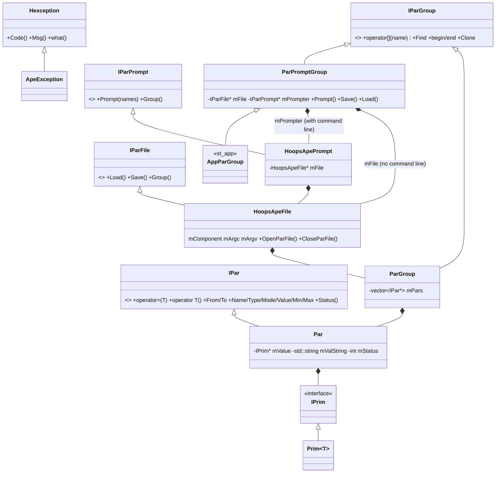

# hoops Architecture

**hoops** ("HEASARC Object-Oriented Parameter System", by James Peachey at
HEASARC/GSFC) gives C++ code typed access to IRAF-style parameter files.
It wraps the C library `ape` and adds:

- `IPar`: one parameter, with conversion to and from every C++ arithmetic
  type and `std::string`.
- `IParGroup`: a named collection of parameters.
- `ParPromptGroup`: "load my tool's par file, apply the command line, and
  prompt".
- `Hexception`: one exception type with numeric codes (`P_SIGNEDNESS`,
  `PAR_NOT_FOUND`, …) that callers test.

Fermi code reaches hoops almost entirely through `st_app::AppParGroup`,
which derives from `hoops::ParPromptGroup`. The par-file behaviour
underneath (PFILES, learning, prompting) is ape's. See
`src/ape/doc/architecture/parameter-files.md`.

The package looks bigger than it is. Of about 43,000 lines, 35,700 are one
unbuilt, machine-generated test (`src/test/hoops_prim_test.cxx`). The
compiled library is 7 source files (about 3,400 lines) plus 11 headers.

## Purpose and scope

**Does:**
- Load a tool's parameters from ape into `Par` objects (name, type, mode,
  value, min, max, prompt, comment).
- Prompt for parameters through ape, one at a time or all in file order.
- Convert values between parameter types (`b`, `i`, `r`, `s`, `f*`) and C++
  types, with range, sign and precision checks reported as `Hexception`
  codes.
- Write values back to the par file through ape (`Save`).

**Does not:**
- Find, parse, merge or write par files itself. ape does all file I/O.
- Know about switch/case parameter dependencies or GUIs. Those are in
  `st_app` (`AppParGroup`, `StAppGui`) and `st_graph` (`StGui`).
- Allow adding or removing parameters through `ParPromptGroup`. Those calls
  throw `PAR_UNSUPPORTED`.

## Position in the system

| Direction | Package | Why |
|-----------|---------|-----|
| Depends on | `ape` | Linked `PRIVATE`. Only `src/hoops_ape.cxx` includes ape headers. No hoops public header includes ape, so clients don't need ape's include path, but because `hoops` is a static library the link to `libape_3` still propagates to them. |
| Used by | `st_app` | `AppParGroup` derives from `hoops::ParPromptGroup` (`st_app/AppParGroup.h`). `StAppGui`/`StGui.h` build widgets from `hoops::IPar`. `StAppFactory.cxx` catches `Hexception` while reading `chatter`/`debug`/`gui`. st_app links hoops `PUBLIC`, so every st_app client gets the hoops headers. |
| Used by | `st_graph` | `StGui` builds a GUI from a `hoops::IParGroup` (links hoops `PUBLIC`). |
| Used by | `map_tools` | `Parameters` and `MapParameters` (which derives from `ParPromptGroup`), and `SkyImage(const IParGroup &)`. Links hoops directly. |
| Used by | `evtbin` | `gtbin.cxx` includes `hoops/hoops_exception.h` and ignores `P_SIGNEDNESS` when reading `nxpix`/`nypix` into `unsigned long`. `BinConfig.cxx` catches `Hexception`. Gets hoops through st_app, with no direct CMake link. |
| Used by | `timeSystem` | `TimeCorrectorApp`/`PulsarTestApp` iterate over `GenParItor`/`ConstGenParItor`. Gets hoops through st_app. |
| Used by | `Likelihood`, `dataSubselector`, `observationSim` | Catch `hoops::Hexception` (usually `PAR_NOT_FOUND`, to treat a parameter as optional). No direct `#include`; the headers come through `st_app/AppParGroup.h`. Likelihood also links hoops `PRIVATE`. |
| Linked by | `sourceIdentify` | `gtsrcid` links hoops but uses no hoops names directly. Its parameters come through st_app. |

The dependency table in `docs/architecture/dependency-layers.md` lists
only the CMake links (Likelihood, map_tools, sourceIdentify, st_app,
st_graph). Through st_app, every `gt*` tool uses hoops at runtime.

## Key abstractions

All types are in namespace `hoops`, with headers in `hoops/`.



| Type | Header | Role |
|------|--------|------|
| `IPar`, `IParGroup`, `IParFile`, `IParPrompt`, factory interfaces | `hoops/hoops.h` | Abstract interfaces. Also `ParErrorCode_e` (`PAR_NOT_FOUND` = 104, …) and `operator<<(ostream, IPar)`, which prints a par-file line. |
| `Par`, `ParFactory` | `hoops/hoops_par.h` | The concrete parameter. Holds the type, mode, etc. as strings, and the value as an `IPrim *` whose C++ type is chosen from the parameter type (`b`→`bool`, `i`→`long`, `f*`/`s`→`std::string`, `r`→`double`; see `Par::ConvertFrom`). |
| `ParGroup` | `hoops/hoops_group.h` | `std::vector<IPar *>` with a name. `Find`/`operator[]` do a linear, case-**sensitive** search and throw `PAR_NOT_FOUND`. Copying clones every `Par`. |
| `ParPromptGroup` | `hoops/hoops_prompt_group.h` | What clients use. Owns one `HoopsApeFile` without the command line (`mFile`, for `Load`/`Save`) and one `HoopsApePrompt` with the command line (`mPrompter`, whose group is the one clients see). |
| `HoopsApeFile`, `HoopsApePrompt`, `ApeException` | `hoops/hoops_ape.h` | The ape bridge, in `src/hoops_ape.cxx`. `ApeException` maps ape status codes to hoops codes (`ape2Hoops`); anything unmapped becomes `P_CODE_ERROR`. |
| `HoopsApeFileFactory`, `HoopsApePromptFactory` | `hoops/hoops_ape_factory.h` | Factories used by `ParPromptGroup`. |
| `IPrim`, `Prim<T>`, `PrimFactory` | `hoops/hoops_prim.h`, `src/hoops_prim.cxx` | Value holder and the full conversion matrix (`Conv::Convert` overloads for every pair of 14 types). This is most of the library code. |
| `Hexception`, `HexceptionCode_e` | `hoops/hoops_exception.h` | The exception type and conversion codes `P_OK`…`P_CODE_ERROR` (0–13). |
| `GenBiDirItor`, `GenParItor`, `ConstGenParItor` | `hoops/hoops_itor.h` | Container-independent iterators over `IPar *`. |
| `Lim<T>`, `hoops::numeric_limits<T>` | `hoops/hoops_limits.h`, `hoops/hoops_numeric_limits.h` | hoops' own copy of `numeric_limits`, for pre-standard compilers. The library is built without `HAVE_LIMITS`, so this copy is the one used. |

## Data flow and control flow

Typical `gt*` run (`st_app` → hoops → ape):

```
StApp::getParGroup() → new st_app::AppParGroup(tool_name)
  └─ hoops::ParPromptGroup(argc-1, argv+1, tool_name)
       ├─ mFile     = new HoopsApeFile(tool_name)            // argv = {tool_name}
       │    └─ Load(): ape_trad_init → read all ApePar fields → new Par(...) each → ape_trad_close(save=1)
       └─ mPrompter = new HoopsApePrompt(argc, argv, tool_name)
            └─ HoopsApeFile(tool_name, args) → Load() again, this time with the command line applied
pars.Prompt()                                     // AppParGroup adds switch/case filtering
  └─ HoopsApePrompt::Prompt(names)
       ├─ ape_trad_init(args)
       ├─ for each name: by type → ape_trad_query_{bool,file_name,long,double,string}
       │      (ape prompts only if the effective mode is 'q', and saves the file after each query)
       │      → par = value                       // INDEF/INF: falls back to ape_trad_get_string
       └─ ape_trad_close(save=0)
double emin = pars["emin"];                       // Par::operator double → Prim<double>::To
pars.Save()                                       // optional; called in ~50 tool sources
  └─ mFile->Group() = mPrompter->Group(); HoopsApeFile::Save()
       ├─ ape_trad_init(no args); for each par: ape_trad_set_<type>(name, value)
       └─ ape_trad_close(save=1)                 // ape reverts unlearned params, writes the local .par
```

Every `Load`, `Prompt` and `Save` opens and closes ape's single global
session (`ape_trad_init`/`ape_trad_close`). hoops holds no ape state
between calls. The parameter values live only in the `Par` objects.

## Public interfaces

### C++ API

Clients normally need only:

```cpp
#include "st_app/AppParGroup.h"     // brings in hoops/hoops_prompt_group.h, hoops.h, hoops_exception.h

st_app::AppParGroup & pars = getParGroup("gtfoo");
pars.Prompt();

double emin = pars["emin"];                   // r → double: OK
long   nbin = pars["enumbins"];               // i → long: OK
std::string algo = pars["algorithm"];         // s → string: OK
bool   flag = pars["clobber"];                // b → bool: OK

// Optional parameter:
try { int chat = pars["chatter"]; } catch (const hoops::Hexception &) { /* PAR_NOT_FOUND */ }

// i → unsigned: the value IS assigned, but P_SIGNEDNESS is thrown (see gotchas)
unsigned long n = 0;
try { pars["nxpix"].To(n); }
catch (const hoops::Hexception & x) { if (x.Code() != hoops::P_SIGNEDNESS) throw; }

pars.Save();                                  // persist learned values now
```

Headers included directly by other packages: `hoops/hoops.h`,
`hoops/hoops_exception.h`, `hoops/hoops_par.h`, `hoops/hoops_group.h`,
`hoops/hoops_prompt_group.h`. Nothing outside hoops uses `hoops_ape.h`,
`hoops_prim.h` (directly), `hoops_limits.h` or the factories.

### Applications

None. `test_hoops` (see [Build and test](#build-and-test)) is built and,
surprisingly, installed to `bin/`.

### Python

None. hoops is not SWIG-wrapped. Python front ends (`sane`'s `gt_apps`)
drive the executables and par files instead.

### Environment variables

None. hoops calls no `getenv`; `PFILES`, `HEADASNOQUERY` and `APEDEBUG`
are read by ape (see the ape doc). Variables set by conda activation are
described under "Runtime environment" in ScienceTools'
`docs/architecture/README.md`.

### File formats

None directly. Par files are read and written by ape.

## Build and test

- **CMake target:** `hoops`, a **static** library (PIC, because the umbrella
  sets `CMAKE_POSITION_INDEPENDENT_CODE ON`). Sources: the 7 files
  `src/hoops_{ape,exception,group,limits,par,prim,prompt_group}.cxx`. It
  links `ape` `PRIVATE`.
- Because hoops is static and is linked by several libraries (st_app and
  st_graph are also static; map_tools and Likelihood link it too), a final
  executable can contain hoops code from more than one route. This is
  harmless in practice because hoops keeps almost no global state (the
  `Conv` statics are constants). The ape session state is in the single
  shared `libape_3`.
- **Install:** headers to `${FERMI_INSTALL_INCLUDEDIR}/hoops`, and
  `data/*.par` (`file.par`, `hoops_par_test.par`, `hoops_sample.par`)
  **flat into `${FERMI_INSTALL_DATADIR}`** (`share/fermitools/data/`, with no
  `hoops/` subdirectory). Library and `test_hoops` go into the
  `fermiTargets` export set.
- **Test executable:** `test_hoops`, built from
  `src/test/hoops_lim_test.cxx` with `HAVE_LIMITS` defined. It only checks
  that `hoops::numeric_limits<T>` agrees with `std::numeric_limits<T>` for
  every type, and exits 1 on any mismatch. It needs no environment, par
  files or data. It is **not registered with CTest**, and the project
  harness `recipe/tests/ST-unit-test` (see "Testing" in ScienceTools'
  `docs/architecture/README.md`) never lists it, so nothing runs it
  automatically; run it by hand. No hoops reference data is installed or
  compared anywhere (the `src/test/outref/` file below belongs to an
  unbuilt test).
- **Unbuilt tests:**
  - `src/test/hoops_prim_test.cxx` (35,724 lines): a machine-generated
    exhaustive test of the conversion matrix. It appears to be generator
    output; for example `ERROR_UNDETECTED = + 1;` is missing a symbol.
  - `src/test/hoops_par_test.cxx`: `Par`/`ParGroup`/ape round-trip tests,
    using `data/hoops_par_test.par` and the reference
    `src/test/outref/hoops_par_test.par`.
  - `src/test/main.cxx`, `src/test/hoops_sample.cxx`: examples. `main.cxx`
    refers to `ApeParFileFactory`/`ApeParPromptFactory`, which no longer
    exist, so it would not compile.

  None of these are built by CMake (the old `SConscript` didn't build them
  either). Nothing in the build tests `Par`, `ParPromptGroup` or the ape
  bridge. In practice that coverage comes from the st_app and tool tests.
- **Legacy files:** `SConscript`, `hoopsLib.py` (SCons). `doc/Doxyfile*`.
- **CI:** `azure-pipelines.yml` uses the shared `fermi-lat/ci` templates.

## Invariants and gotchas

**Conversions throw even when they succeed**
- Converting between a signed and an unsigned type **always** throws
  `P_SIGNEDNESS`, even when the value fits. Converting between an integer
  and a floating type **always** throws `P_PRECISION`. In both cases the
  destination has **already been assigned** before the throw
  (`Conv::Convert` in `src/hoops_prim.cxx`). That is why `gtbin` catches
  `P_SIGNEDNESS` around `pars["nxpix"].To(unsigned long&)` and carries on.
- Consequences: `double x = pars["some_int_par"]` throws; `pars["emin"] = 100`
  (an `int` assigned to an `r` parameter) throws `P_PRECISION` even though the
  value is stored. Read `i` parameters as `long`/`int` and `r` parameters as
  `double`, and assign `100.` rather than `100`. Narrowing integer
  conversions (`long`→`int`, `short`) only throw on overflow
  (`sThrowBadSize` is `false`).

**Undefined, infinite and blank values**
- `INDEF`/`NONE`/`UNDEF`/`UNDEFINED` (and, for reals, `INF`/`INFINITY`/`NAN`)
  are accepted when loading. The `Par` records `P_UNDEFINED`/`P_INFINITE` in
  `Status()` and keeps the string. Any **numeric read** then throws that
  code. `Value()` (string) never throws. Check `Status()` or catch the
  exception for optional numeric parameters.
- A **blank** numeric value (e.g. `enumbins,i,a,,,,`) is different. It
  leaves `mValue` null with status `P_OK`, and numeric reads silently
  return `0` / `false` (`Par::ConvertTo`: `p = T()`). Because `Save()`
  writes through `ape_trad_set_long`/`_double`/`_bool`, a blank learned
  numeric parameter is written back as `0` (or `no`) by `Save()` (from
  reading the code; not checked at runtime).

**String parsing**
- Integers are parsed with `strtol(s, &r, 0)`, so `010` is read as **8**
  (octal) and `0x10` as 16.
- On integer overflow (`ERANGE`), `Convert(const std::string&, signed long&)`
  sets the destination to `Lim<signed short>::max()` (32767), not
  `LONG_MAX`, before throwing `P_STR_OVERFLOW`. This looks like a
  copy-paste bug (from reading the code; not checked at runtime).
- Booleans accept `yes/y/true/t/1` and `no/n/false/f/0`, case-insensitive.
  Anything else throws `P_STR_INVALID`.
- Doubles are formatted with `%1.15g` (`Value()`, and ape's
  `ape_session_set_double` on `Save`), which is not enough for an exact
  round trip.

**Par-file side effects**
- **Constructing a `ParPromptGroup` (so any `AppParGroup`) writes the local
  par file twice.** Each internal `Load()` ends with `ape_trad_close(1)`.
  Learned parameters given on the command line are therefore persisted
  before the tool has run or validated anything. `st_app`'s
  `IStAppFactory::configureApp` builds an extra `AppParGroup` just to read
  `chatter`/`debug`/`gui`, which adds more open/write cycles.
- `ParPromptGroup::Load()` reloads from `mFile`, which has **no command
  line**, so it discards command-line values in the visible group. No Fermi
  code calls it today.
- `ParPromptGroup::Add`/`Remove` always throw `PAR_UNSUPPORTED`.

**Copies are lossy**
- `Par(const Par &)` and `Par(const IPar &)` initialize `mMin` and `mMax`
  to empty strings (`src/hoops_par.cxx`). Any clone (copying a `ParGroup`,
  a `ParPromptGroup`, `HoopsApePrompt::Clone`, or the copy that
  `ParPromptGroup::Save` makes) loses the range and enumeration. This
  matters for code that reads `Min()`/`Max()` from a copied group, such as
  GUI enumeration lists or `map_tools::MapParameters(ParPromptGroup &)`.
- `Par::operator=(const Par &)` copies only the **value**, not the name,
  type or mode.

**Lookup**
- Parameter lookup in a group is **case-sensitive** and exact, unlike
  ape's command line, which is case-insensitive and allows abbreviations.
- `ParGroup::Remove(name)` erases inside a `for` loop and then increments
  the invalidated iterator. Removing the last element is undefined
  behaviour (from reading the code; it is unreachable through
  `ParPromptGroup`).

**Exceptions**
- `Hexception::what()` returns the message only. The `__FILE__`/`__LINE__`
  passed to the constructor are stored but never shown.
- `ApeException::Code()` is the **hoops** code. `ApeCode()` is the original
  ape status. Unmapped ape errors (for example file not found) all become
  `P_CODE_ERROR` (13).
- Codes are two separate numeric ranges: conversion codes `P_*` (0–13, in
  `hoops_exception.h`) and parameter codes `PAR_*` (101–108, in `hoops.h`).

**Documentation**
- `doc/release.notes` ends in 2010 (v1r1p4 import from HEASARC). Comments
  in the code still mention PIL, which was replaced by ape in 2008.

## Extension points

- **Read a parameter in a new tool:** don't touch hoops. Use
  `st_app::AppParGroup` and the idioms in [Public interfaces](#c-api).
- **New parameter type:** add a branch, in the same order (check `f`
  before `r`, because `fr` is a file type), to `Par::ConvertFrom`
  (`hoops/hoops_par.h`), `HoopsApeFile::Save` and `HoopsApePrompt::Prompt`
  (`src/hoops_ape.cxx`), and to `operator<<` in `src/hoops_par.cxx`. ape
  must support the type first.
- **New ape error mapping:** add a `case` to `ApeException::ape2Hoops`.
  Callers that test `Code()` may then see a different code than before.
- **Relaxing the signedness/precision exceptions** would change behaviour
  that callers rely on (`gtbin`, and every `catch (hoops::Hexception &)`
  that treats a throw as "parameter not usable"). Audit the callers listed
  in [Position in the system](#position-in-the-system) first.

hoops is vendored HEASARC code. Keep Fermi changes small so the code can
still be compared with upstream HEASoft hoops.

## Further reading

- `src/ape/doc/architecture/README.md` and `parameter-files.md`: PFILES,
  merging, modes, prompting and learning.
- `src/st_app/` (`AppParGroup`, `StApp`): how tools obtain and prompt for
  parameters, including switch/case prompting.
- `doc/release.notes`: version history up to 2010.
- `data/hoops_sample.par`: a small example par file covering each type.
